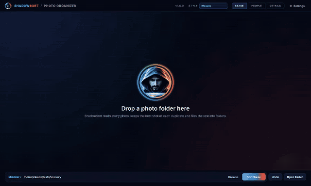
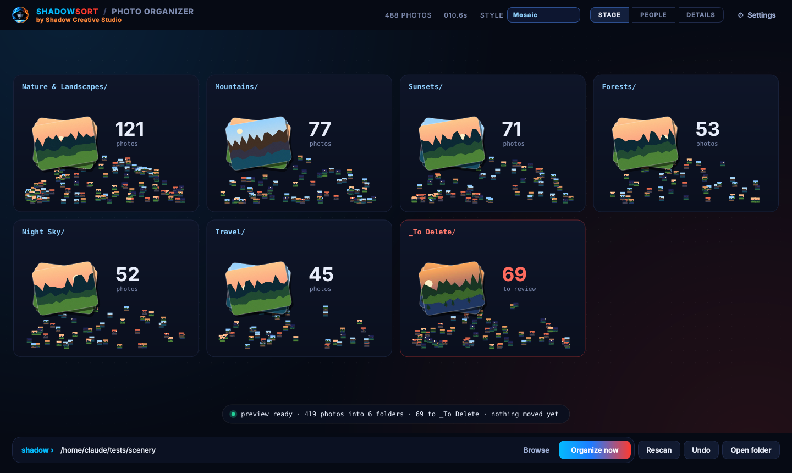
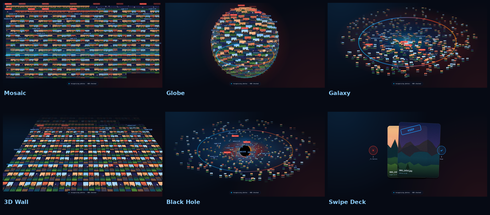
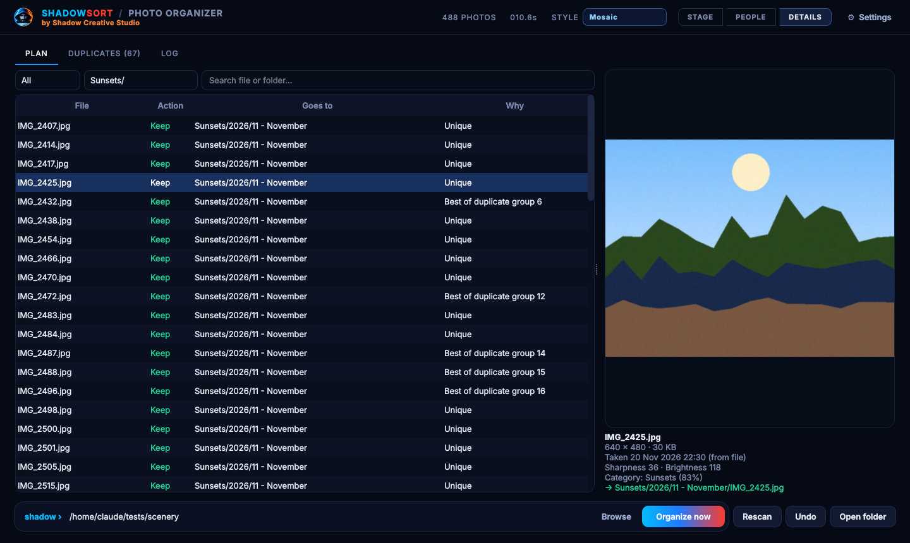
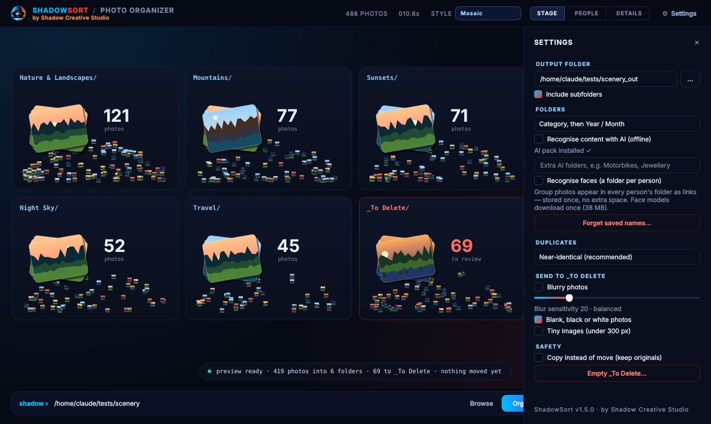

<p align="center">
  
</p>

<h1 align="center">ShadowSort</h1>

<p align="center">
  <strong>by Shadow Creative Studio</strong><br />
  A smart photo organizer for Windows. Point it at a messy folder: it makes the folders, sorts every photo,
  keeps the best copy of each duplicate, gives every person their own folder, and never deletes anything.
</p>

<p align="center">
  
  
  
  
</p>

<p align="center">
  
</p>

## Download

| | |
|---|---|
| **Installer** | Download **`ShadowSort-Setup-1.5.0.exe`** from [Releases](https://github.com/mrchhan/shadowsort/releases) and run it. It adds a Start menu entry and a desktop shortcut. |
| **Portable** | **`ShadowSort-Portable-1.5.0.zip`**: unzip anywhere and run `ShadowSort.exe`. No install needed. |

> Windows may show *"Windows protected your PC"* because the installer isn't code-signed yet. Click **More info → Run anyway**.

## How it works

1. **Drop a folder** of photos onto the window (or type its path after `shadow ›`) and press **Sort these**.
2. **Watch the preview.** Every photo appears on screen, a scanner reads and tags it, and it flies into its folder card. **Nothing on your disk changes yet.**
3. **Check anything you like.** Click a folder card to see exactly which files go there, and open **People** to name everyone.
4. Press **Organize now**. Changed your mind? **Undo** puts every file back where it was.

<p align="center"></p>

## Features

### Folders made for you
- **By what's in the photo** *(optional offline AI)*: People, Selfies, Food, Pets, Cars, Documents & Receipts, Screenshots, Nature, Events… You can add your own folders too, such as `Motorbikes` or `Jewellery`.
- **By date:** `2025 / 03 - March`, read from the camera's own date inside each photo. If that's missing it uses the date in the file name (WhatsApp, Android), then the file's date.
- Or both: `Food & Drinks / 2025 / 03 - March / IMG_1234.jpg`.

### Duplicates: keeps the best one
- Finds **exact copies** and **near-identical ones**: resized, re-saved, WhatsApp-compressed, or (optionally) burst shots.
- Scores each copy on **sharpness, resolution, exposure and original camera data**, keeps the winner and moves the rest to `_To Delete/Duplicates`. Each duplicate is numbered so you can compare it with the copy that was kept.

### Junk goes to `_To Delete`
- Blurry photos (sensitivity slider), blank / black / white shots, files that won't open and, optionally, tiny icons and stickers.
- **ShadowSort never deletes anything itself.** You review `_To Delete` and empty it when you're ready. It goes to the Recycle Bin.

### A folder for every person
- Finds every face, groups the same person across all your photos and shows them in the **People** tab. Name someone once and they're recognised automatically next time.
- **Group photos appear in every person's folder without using extra space.** The photo is stored once and each person's folder gets a Windows *hard link* to it, which opens like a normal file.
- **Fix mistakes in seconds:** drag one card onto another to join them, use **Photos / fix** to move wrong faces out, or **Hide** someone.
- **Export a ZIP per person** (`Ali.zip`, `Sara.zip`…), ready for WhatsApp, email or USB.

### 9 animation styles
Mosaic, Globe, Galaxy, 3D Wall, Neural, Swipe Deck, Polaroid Desk, Matrix Rain and Black Hole. Pick one from **STYLE** in the top bar.

<p align="center"></p>

### Safe by design
- **Preview first:** nothing moves until you press *Organize now*.
- **Undo** restores every file to its original place.
- **Copy mode** leaves your original folder untouched.
- **Never overwrites:** clashing names get `(2)`, `(3)`…
- **A CSV report** lists every file, where it went and why.

### Private and offline
Everything runs on your PC. **No account, no upload and no subscription.** The face models (38 MB) are included. The optional content-recognition AI downloads once and then works offline too.

<p align="center">
  
  
</p>

---

## Output layout

```
ShadowSort Organized/
├── People/2025/03 - March/IMG_1234.jpg
├── Food & Drinks/2024/12 - December/…
├── Screenshots/…
├── By Person/
│   ├── Ali/        ← links, no extra disk space
│   └── Sara/
├── _To Delete/
│   ├── Duplicates/G001_IMG_1234 copy.jpg
│   ├── Blurry/
│   ├── Blank or Dark/
│   └── Unreadable/
└── ShadowSort report 20261120-150400.csv
```

## Run from source

Requires **Python 3.10+** on Windows.

```bat
run.bat          :: basic folders (Screenshots / Camera Photos / WhatsApp / Images) + faces
run.bat ai       :: adds AI content recognition (installs PyTorch, about 1 GB; the model downloads once)
```

Or manually:

```bat
python -m venv .venv && .venv\Scripts\activate
pip install -r requirements.txt
python main.py
```

Tests: `pip install pytest && python -m pytest`.

## Build the .exe and installer

```bat
build.bat        :: dist\ShadowSort\ShadowSort.exe  (face models bundled)
build.bat ai     :: also bundles the content-recognition AI
```

Then open `installer.iss` in [Inno Setup](https://jrsoftware.org/isinfo.php) and press **Compile**.

**Automatic releases:** on GitHub, open **Actions → Release Windows app → Run workflow**, or push a tag such as `v1.5.0`. GitHub builds the installer and the portable zip on Windows and attaches them to a new Release.

## How it works inside

| Part | How |
|---|---|
| Duplicates | SHA-256 for exact copies, plus perceptual pHash + dHash for near-identical photos |
| Best copy | Laplacian sharpness, resolution, exposure, EXIF camera data |
| Dates | EXIF `DateTimeOriginal`, then the date in the file name, then the file date |
| Content | OpenAI CLIP (ViT-B/32), zero-shot, offline |
| Faces | OpenCV YuNet (detection) + SFace (recognition), offline; same-photo faces are never merged |
| UI | PySide6 (Qt 6) with custom-painted animations |

```
main.py                   entry point
shadowsort/analyzer.py    per-photo analysis: hashes, date, sharpness, exposure
shadowsort/engine.py      duplicates, best pick, junk, plan / apply / undo, people folders, report
shadowsort/classifier.py  AI and basic content categories
shadowsort/faces.py       face detection, grouping, saved names, ZIP export
shadowsort/stage.py       animated stage
shadowsort/styles.py      the 9 animation styles
shadowsort/gui.py         main window, People and Details views, settings
tests/                    pytest suite (runs in CI on Windows and Linux)
```

## Tips
- **Portrait-mode photos landing in Blurry?** Lower the blur sensitivity in Settings.
- **One person shown twice?** Drag one card onto the other, or tap **✓ Same** in the *Same person?* bar.
- **Face matching** works best on clear, front-facing faces. Side profiles, sunglasses and very small background faces may be left out.

## License

[MIT](LICENSE) © 2026 Hassan Malik · Shadow Creative Studio
